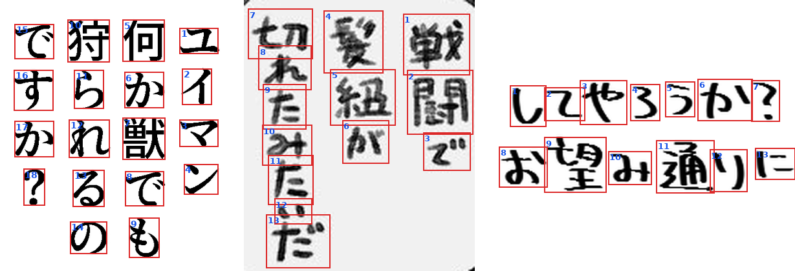
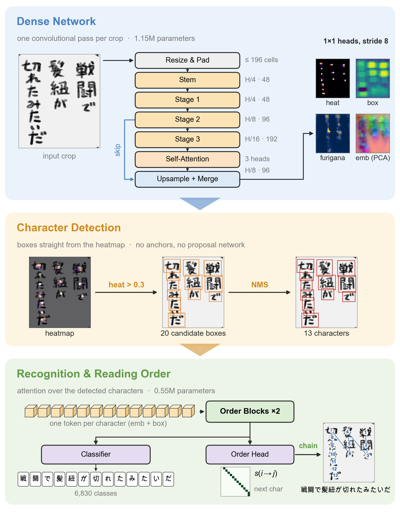

# manga-ocr-charspot-nano

English | [中文](README_zh.md) · [GitHub](https://github.com/muscgab/manga-ocr-charspot) · [Hugging Face](https://huggingface.co/muscgab/manga-ocr-charspot-nano) · [ModelScope](https://modelscope.cn/models/muscgab/manga-ocr-charspot-nano) · [Technical report](TECHNICAL_REPORT.md)

OCR for Japanese manga text boxes with 1.7M parameters. The model detects every character in a cropped text box, classifies it, and puts the characters in reading order with a small learned ordering head. There is no text decoder. Besides the text, it returns a box and a score for each character.



Model output on three Read v1.3 boxes: character boxes (red) and reading order (blue). The crops are from [JMangaBench_Read](https://github.com/muscgab/JMangaBench_Read) (CC BY-NC-SA 4.0); they were picked from boxes the model reads correctly.

## Accuracy

### JMangaBench_Read v1.3 (same domain, not used for training or model selection)

[JMangaBench_Read v1.3.1](https://github.com/muscgab/JMangaBench_Read), 7,789 boxes, official scorer (RIN v1.1). "New" = the 4,660 boxes added in v1.3; Read v1.2 was the development set (see [Evaluation notes](#evaluation-notes)).

| Model | Params | Composite ↑ | CER % ↓ | EM % ↑ | EM new % ↑ | EM printed % ↑ | EM non-printed % ↑ |
|---|---|---|---|---|---|---|---|
| **manga-ocr-charspot-nano** | **1.7M** | 95.74 | 2.14 | 89.38 | 89.55 | **95.59** | 70.29 |
| manga-ocr-nar-small | 54M | 97.29 | 1.71 | 91.36 | 91.65 | 94.74 | 80.96 |
| manga-ocr-nar-small-distil | 30M | 96.40 | 2.29 | 89.09 | 88.95 | 93.21 | 76.41 |
| Hayai v2.5 Nova p384 | 157M | 96.64 | 2.38 | 88.18 | 88.41 | 91.93 | 76.62 |
| PaddleOCR-VL-For-Manga | 959M | 95.04 | 1.99 | 87.89 | 87.92 | 95.17 | 65.53 |
| mangaOCR | 111M | 90.27 | 4.81 | 78.51 | 78.48 | 88.34 | 48.27 |

EM is the share of boxes whose normalized prediction equals the normalized label exactly; CER is the total edit distance divided by the total number of label characters. Composite is Read's ranking metric (1 − normalized edit distance, printed and non-printed weighted equally); the weak non-printed side puts this model below Nova on it while its EM is higher.

### Manga109-s (different domain, not used for training)

All 123,014 text annotations of Manga109-s (scanned commercial manga, 87 volumes), cropped with the dataset's own boxes; labels and predictions normalized with RIN v1.1; EM and CER as above. Models trained on Manga109-s (Hayai, mangaOCR) are not listed. baberuOCR v1.1 (training data not published) uses the generation settings of the Read leaderboard; Preview is [manga-ocr-nar-preview](https://huggingface.co/muscgab/manga-ocr-nar-preview).

| Model | Params | EM % ↑ | CER % ↓ | EM 1–4 chars | 5–16 | 17–32 | > 32 |
|---|---|---|---|---|---|---|---|
| **manga-ocr-charspot-nano** | **1.7M** | 89.10 | 1.98 | 94.27 | 90.37 | 84.46 | 60.21 |
| manga-ocr-nar-small | 54M | 92.08 | 1.39 | 95.92 | 92.23 | 90.11 | 74.39 |
| baberuOCR v1.1 | 113M | 86.68 | 2.51 | 94.73 | 87.92 | 79.75 | 54.40 |
| Preview | 196M | 86.51 | 2.46 | 91.74 | 87.30 | 83.22 | 55.59 |

Boxes per length bucket: 26,336 / 65,916 / 27,580 / 3,182.

## Speed

End to end per crop (image already decoded; preprocessing, network, decoding and reading order included), batch 1, p50 over all 7,789 Read v1.3 boxes.

**CPU** (ONNX Runtime fp32, 8 threads):

| Model | Format | Xeon Gold 6148 | M1 Pro |
|---|---|---|---|
| **manga-ocr-charspot-nano** | ONNX fp32 | 8.0 ms | 6.3 ms * |
| manga-ocr-nar-small-distil | ONNX int8 | 37.3 ms | 21.0 ms |
| manga-ocr-nar-small | ONNX fp32 | 58.2 ms | — |

\* measured on a laptop under load (load average 5–15); the Xeon was idle.

**NVIDIA GPU** (RTX 2080 Ti, Read's speed protocol: per image = batch 1; per page = one page's boxes per call, p50; max img/s = best batch with CPU preprocessing in worker processes):

| Model | Per image ↓ | Per page ↓ | Max img/s ↑ |
|---|---|---|---|
| **manga-ocr-charspot-nano** (CUDA graphs, fp16) | 4.7 ms | 28.6 ms | 648 |
| manga-ocr-nar-small-distil | 8.4 ms | 35.0 ms | 287 |
| manga-ocr-nar-small | 9.1 ms | 35.5 ms | 299 |
| Hayai v2.5 Nova p384 | 54.0 ms | 252.0 ms | 175 |
| mangaOCR | 84.9 ms | 242.4 ms | 42 |

Rows other than manga-ocr-charspot-nano are taken from the [Read leaderboard](https://github.com/muscgab/JMangaBench_Read) and the manga-ocr-nar-small model card (same machines and protocols). manga-ocr-charspot-nano was measured after `warmup()` (11 s once at start; it captures the CUDA graphs for the 17 input canvases of the development set; 3.1 GB of GPU memory afterwards). The CUDA backend pads crops of a call to a few canvas sizes and runs each canvas as one masked batch; with a 1.7M-parameter network the GPU is mostly idle, and the per-call CPU work (box decoding, NMS, ordering) sets the limit.

After an idle pause the processor clocks down and the next crop is slower: on the idle Xeon (governor `powersave`) 15 ms after 1–20 s idle instead of about 8 ms; on the RTX 2080 Ti 8.9 ms after 1–5 s and 24 ms after 20 s instead of 4.2 ms. Locking the clocks avoids it.

## Usage

```bash
git clone https://huggingface.co/muscgab/manga-ocr-charspot-nano   # or: modelscope download --model muscgab/manga-ocr-charspot-nano --local_dir manga-ocr-charspot-nano
cd manga-ocr-charspot-nano
pip install -e ".[cpu]"   # ONNX Runtime (CPU); ".[cuda]" for the PyTorch GPU backend
manga-ocr-charspot-nano crop.png            # one "path<TAB>text" line per crop
manga-ocr-charspot-nano --chars crop.png    # one JSON line per crop with per-character boxes and scores
```

```python
from manga_ocr_charspot_nano import MangaOcrCharspotNano

ocr = MangaOcrCharspotNano()                    # backend "auto" (CUDA if available, else ONNX on CPU), "onnx" or "cuda"
ocr("crop.png")                         # -> str
ocr(["a.png", "b.png"])                 # -> list of strings
ocr.read("crop.png")                    # -> {"text": ..., "chars": [{"char": "今", "box": [x0, y0, x1, y1], "score": 0.93}, ...]}
ocr.warmup()                            # CUDA backend: capture the CUDA graphs once (about 11 s); no-op on CPU
```

`model.onnx` is the whole model after preprocessing in one graph (box decoding, NMS and reading order included), so it can also be used from other languages and runtimes: input `img` [1, 3, H, W] (the preprocessed crop, raw 0–255), outputs `boxes` [N, 4], `scores` [N], `ids` [N] and `order` [N] (reading order as indices).

`read` returns the characters in reading order; boxes are in pixels of the given crop, the score is the character-centre heatmap peak. A combined `!?` glyph is one entry with a two- or three-character string. Inputs may be file paths, PIL images or uint8 RGB arrays. The model files are read from the repository directory; `MangaOcrCharspotNano(model_dir=...)` or `MANGA_OCR_CHARSPOT_NANO_DIR` points elsewhere.

## How it works

<p align="center"></p>

Top to bottom: one convolutional pass gives four stride-8 maps; heatmap cells above 0.3 propose boxes and NMS leaves one box per character; attention over the characters classifies each one and scores every possible next character, and a greedy chain reads off the order. The heatmap, boxes, scores and order are the model's real outputs on a Read v1.3 crop. Vector version: [samples/pipeline.pdf](samples/pipeline.pdf).

- **Input**: the crop is resized with its aspect ratio kept to at most 196 cells of 16 × 16 px and padded with the median border colour.
- **Backbone**: depthwise-separable CNN (48 / 96 / 192 channels) with one self-attention block at stride 16, merged into a stride-8 feature map.
- **Dense heads** (stride 8): character-centre heatmap, character box, furigana flag, 64-d character embedding.
- **Decoding**: heatmap peaks above 0.3 → boxes → NMS (IoU 0.2, plus removal of boxes whose centre lies inside a kept box) → furigana removed → each character classified (6,817 characters + 12 combined `!?` glyphs for tate-chū-yoko).
- **Reading order**: one self-attention block over the detected characters (embedding + box geometry), a pairwise "next character" score and start / end scores; the order is read off greedily. The same mechanism covers columns, rows, multi-column boxes and curved text.

## Training

| Stage | Data | Steps (batch 1,024) | Schedule |
|---|---|---|---|
| 1 | Synthetic crops with character boxes: 3,463,874 | 34,050 (10 epochs) | AdamW, OneCycle, peak LR 4e-3 |
| 2 | Synthetic 4,291,646 (printed 1,992,408, handwriting 2,299,238) + AnimeText-OCR 1,006,116 real crops, text labels only | 31,068 (6 epochs) + 4,660 cool-down | AdamW, constant LR 2e-3, then 1 − √t decay to 0 |

- Real crops have no character boxes. Following [PageNet](https://arxiv.org/abs/2207.14807) (Peng et al., IJCV 2022), at the start of each epoch the current model reads every real crop, its output is aligned to the text label, and only characters that match the label exactly become training boxes; boxes are merged across epochs with PageNet's score-weighted update. Heatmap negatives come only from the space between matched neighbouring characters. After 6 epochs, 997,401 of the 1,005,758 usable crops carried 12,319,134 pseudo character boxes.
- 4 × RTX 2080 Ti, fp16 mixed precision.

## Limitations

- **Non-printed text**: EM 70.29 on Read v1.3 vs 80.96 for manga-ocr-nar-small. Each character is classified from its own features, without language context; look-alike characters in rough handwriting are the main error.
- **Horizontal text**: EM 65.83 on the 439 horizontal Read boxes vs 84.51 for manga-ocr-nar-small.
- **Long boxes**: more than 32 characters, 60.21 vs 74.39 for manga-ocr-nar-small on Manga109-s (3,182 boxes); on Read (169 boxes) 71.01 vs 73.96.
- Real-data supervision only covers characters the model already reads correctly on that crop; characters it never reads correctly are learned from synthetic data only.
- Read boxes come from one detector (AnimeText YOLO12x, tight text blocks), the same kind of crop as the real training data; Manga109-s uses its own annotation boxes.

## Evaluation notes

- Read v1.2 (3,142 boxes, part of v1.3) was the development set: checkpoint choice, NMS threshold and error analysis. The 4,660 new boxes of v1.3 were not used for any decision.
- Manga109-s was not used for training, model selection or tuning.
- The scores are the outputs of the released ONNX package (CPU, fp32), identical to the PyTorch fp32 outputs on all 7,789 Read boxes. The CUDA backend runs the dense network in fp16: on Read v1.3 its per-image output differs from the CPU output on 5 of 7,789 boxes (EM 89.37 vs 89.38), its per-page batched output on 7 boxes (EM 89.38, all 7 wrong either way).

## Acknowledgements

- [PageNet](https://arxiv.org/abs/2207.14807) (Peng et al., IJCV 2022): character detection on a grid, and weak supervision of real crops that have only text labels (pseudo character boxes matched to the label, score-weighted update across epochs).
- [CenterNet](https://arxiv.org/abs/1904.07850) (Zhou et al., 2019): character-centre heatmap with Gaussian targets and the penalty-reduced focal loss, box regression at the peak.
- [KuroNet](https://arxiv.org/abs/1910.09433) (Clanuwat et al., ICDAR 2019): reading Japanese text by per-location character detection and classification.
- Reading order as pairwise successor relations: [Zhang et al.](https://arxiv.org/abs/2409.19672) (EMNLP 2024), [Hakim et al.](https://arxiv.org/abs/2607.01018) (2026); character ordering from coordinates: [Lamb et al.](https://arxiv.org/abs/2106.06786) (2021).
- [PaddleOCR](https://github.com/PaddlePaddle/PaddleOCR): layout of the backbone stem, blocks and downsampling (small PP-OCR recognition backbone). [CPVT](https://arxiv.org/abs/2102.10882): positional convolution before attention. [MobileNetV3](https://arxiv.org/abs/1905.02244): hard-swish and hard-sigmoid squeeze-excite.
- [Cluster-NMS](https://arxiv.org/abs/2005.03572): parallel NMS in pseudo-labelling and in `model.onnx`.
- [Hägele et al.](https://arxiv.org/abs/2405.18392) (NeurIPS 2024): constant learning rate with a 1 − √t cool-down.
- [AnimeText](https://arxiv.org/abs/2510.07951) and [AnimeText-OCR](https://huggingface.co/datasets/JustANormalTinkerer/animetext-ocr): real training crops; the real kana glyphs of the synthetic handwriting were also cut from AnimeText images and upscaled with [Real-ESRGAN](https://arxiv.org/abs/2107.10833).
- [Manga109](http://www.manga109.org/) ([Matsui et al., 2017](https://arxiv.org/abs/1510.04389); [Aizawa et al., 2020](https://arxiv.org/abs/2005.04425)): Manga109-s for evaluation.
- mangaOCR, Hayai, baberuOCR and PaddleOCR-VL-For-Manga: comparison models from the Read leaderboard.

## License

Code: Apache-2.0. Weights: CC BY-NC-SA 4.0 (trained on AnimeText-OCR). Data sources and attribution: [NOTICE.md](NOTICE.md).
