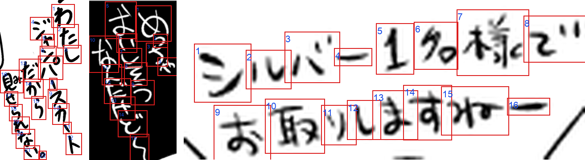

# manga-ocr-charspot-small

[English](README.md) | 中文 · [GitHub](https://github.com/muscgab/manga-ocr-charspot) · [Hugging Face](https://huggingface.co/muscgab/manga-ocr-charspot-small) · [ModelScope](https://modelscope.cn/models/muscgab/manga-ocr-charspot-small)

日文漫画文本框 OCR，11M 参数。它是 [manga-ocr-charspot-nano](https://huggingface.co/muscgab/manga-ocr-charspot-nano) 的大号版本，做法相同：模型在裁好的文本框里检测每一个字、逐字分类，再用一个小的阅读顺序模块把字排成文本。没有文本解码器。除了文字，还输出每个字的框和分数。



模型在三个 Read v1.3 框上的输出：红框是逐字框，蓝色数字是阅读顺序。裁图来自 [JMangaBench_Read](https://github.com/muscgab/JMangaBench_Read)（CC BY-NC-SA 4.0），从模型读对的框中挑选。

## 精度

### JMangaBench_Read v1.3（同领域，未用于训练和选模型）

[JMangaBench_Read v1.3.2](https://github.com/muscgab/JMangaBench_Read)，7,789 框，官方评分脚本（RIN v1.2）。“新增”= v1.3 新加的 4,660 框；Read v1.2 是开发集（见[评测说明](#评测说明)）。所有行都用同一评分脚本、按排行榜的预测文件重新打分。

| 模型 | 参数 | 综合分 ↑ | CER % ↓ | EM % ↑ | 新增 EM % ↑ | 印刷 EM % ↑ | 非印刷 EM % ↑ |
|---|---|---|---|---|---|---|---|
| **manga-ocr-charspot-small** | **11M** | 97.17 | **1.37** | **92.37** | **92.62** | **96.49** | 79.71 |
| manga-ocr-charspot-nano | 1.7M | 95.75 | 2.14 | 89.40 | 89.57 | 95.59 | 70.35 |
| manga-ocr-base-CPT-flex | 111M | **97.47** | 1.50 | 91.71 | 91.93 | 94.50 | **83.11** |
| manga-ocr-nar-small | 54M | 97.29 | 1.71 | 91.36 | 91.65 | 94.74 | 80.96 |
| manga-ocr-nar-small-distil | 30M | 96.40 | 2.29 | 89.09 | 88.95 | 93.21 | 76.41 |
| Hayai v2.5 Nova p384 | 157M | 96.64 | 2.37 | 88.20 | 88.45 | 91.95 | 76.67 |
| PaddleOCR-VL-For-Manga | 959M | 95.04 | 1.99 | 87.91 | 87.94 | 95.17 | 65.59 |
| mangaOCR | 111M | 90.27 | 4.81 | 78.51 | 78.48 | 88.34 | 48.27 |

EM 是规范化后预测与规范化后标签完全相同的框所占比例（本模型的 95% 置信区间 91.76–92.94）；CER 是编辑距离总和除以标签总字数。综合分是 Read 的排名指标（1 − 归一化编辑距离，印刷与非印刷各占一半）；本模型非印刷较弱，所以综合分低于 manga-ocr-base-CPT-flex 和 manga-ocr-nar-small，而 EM 更高。

### Manga109-s（不同领域，未用于训练）

Manga109-s 全部 123,014 条文字标注（扫描版商业漫画，87 卷），按数据集自带的框裁图；标签和预测都用 RIN v1.2 规范化；EM、CER 定义同上。在 Manga109-s 上训练过的模型（Hayai、mangaOCR）不列。baberuOCR v1.1（训练数据未公开）用 Read 排行榜的生成设置；Preview 是 [manga-ocr-nar-preview](https://huggingface.co/muscgab/manga-ocr-nar-preview)。

| 模型 | 参数 | EM % ↑ | CER % ↓ | EM 1–4 字 | 5–16 | 17–32 | > 32 |
|---|---|---|---|---|---|---|---|
| **manga-ocr-charspot-small** | **11M** | 91.13 | 1.44 | 93.93 | 92.03 | 88.18 | **75.11** |
| manga-ocr-charspot-nano | 1.7M | 89.10 | 1.98 | 94.27 | 90.37 | 84.46 | 60.21 |
| manga-ocr-nar-small | 54M | **92.08** | **1.39** | **95.92** | **92.23** | **90.11** | 74.39 |
| baberuOCR v1.1 | 113M | 86.68 | 2.51 | 94.73 | 87.92 | 79.75 | 54.40 |
| Preview | 196M | 86.52 | 2.46 | 91.74 | 87.30 | 83.22 | 55.59 |

各长度档框数：26,336 / 65,916 / 27,580 / 3,182。

## 速度

逐张端到端（图像已解码；含预处理、网络、解码和阅读顺序），batch 1。

**CPU**（Xeon Gold 6148；从 Read v1.3 随机抽 1,000 框，种子 0；逐张 p50；EM 也在这 1,000 框上算）：

| 模型 | 运行方式 | 8 线程 ↓ | 4 线程 ↓ | EM % ↑ |
|---|---|---|---|---|
| **manga-ocr-charspot-small** | ONNX Runtime fp32 | 19.5 ms | 27.0 ms | **93.0** |
| manga-ocr-charspot-nano | ONNX Runtime fp32 | **7.0 ms** | **7.9 ms** | 91.0 |
| manga-ocr-nar-small-distil | ONNX Runtime int8 | 37.4 ms | 54.4 ms | 89.7 |
| manga-ocr-nar-small | ONNX Runtime fp32 | 74.8 ms | 106.4 ms | 92.7 |
| Hayai v2.5 Nova p384 | PyTorch fp32 | 293.8 ms | 438.3 ms | 89.3 |
| baberuOCR v1.1 | PyTorch fp32 | 197.2 ms | 278.1 ms | 81.5 |
| PaddleOCR-VL-For-Manga | PyTorch fp32 | 1,871 ms | — | 88.9 |

各模型用发布的包或 Read 排行榜的适配器（生成参数相同），CPU 默认精度；先预热 20 张，再对 1,000 框各计时一遍，绑定在一颗 CPU 的核上，另一颗 CPU 上最多同时跑一个别的模型（PaddleOCR-VL 只测 8 线程）。4 线程和 8 线程的输出完全一致。1,000 框上 EM 的 95% 置信区间约为 ±1.5–2.5 个百分点（本模型 91.3–94.4）。在 M1 Pro 上（8 线程，全部 7,789 框，笔记本有负载）本模型逐张 p50 为 28.1 ms。

**NVIDIA GPU**（RTX 2080 Ti；各行都按 [Read 排行榜](https://github.com/muscgab/JMangaBench_Read)的方法测：逐张 = batch 1，7,789 框的平均；逐页 = 按真实页面框数分成的 896 批（平均每批 8.7 框）的 p50；最大 img/s = 最佳 batch 下的吞吐，预处理在 4 个 CPU 工作进程里做）：

| 模型 | 逐张 ↓ | 逐页 ↓ | 最大 img/s ↑ |
|---|---|---|---|
| **manga-ocr-charspot-small**（fp32，CUDA graphs） | 7.2 ms | 43.2 ms | 274 |
| manga-ocr-charspot-nano（fp16，CUDA graphs） | 5.2 ms | 28.3 ms | 633 |
| manga-ocr-nar-small-distil | 8.4 ms | 35.0 ms | 287 |
| manga-ocr-nar-small | 9.1 ms | 35.5 ms | 299 |
| Hayai v2.5 Nova p384 | 54.0 ms | 252.0 ms | 175 |
| mangaOCR | 84.9 ms | 242.4 ms | 42 |

本模型以 fp32 运行。缩放在 GPU 上做（逐位复现 Pillow 的 bicubic）；框解码和 NMS 在 8 张以内的调用里放在 CPU 上做，更大的调用在 GPU 上批量做；分类和阅读顺序在 GPU 上做。CUDA graph 覆盖 8 张以内的调用，更大的调用按普通 PyTorch 运行，结果相同。单进程每次调用 1,024 张时可达 289 img/s。测量在 `warmup()` 之后（启动时一次约 7 s，录制 52 张 CUDA graph，之后占 GPU 显存 4.4 GB）。CUDA 后端在全部 7,789 个 Read 框上输出与 CPU 版 ONNX 包相同的文字。

闲置 0.5–10 s 后 GPU 降频（1,350 MHz），下一张需要 11.0–11.9 ms（中位数），连续调用时为 6.6 ms；闲置 20 s 后第一张需要 32.9 ms（Read 的首张测试）。锁定频率可以避免。

显存小于 4 GB 的 GPU 上，后端自动改用更小的调用并关闭 CUDA graph：在把 PyTorch 显存限制为 1.4 GB 的测试中，整卡共占 1.5 GB，逐张 17 ms，吞吐 240 img/s。

## 使用

```bash
git clone https://huggingface.co/muscgab/manga-ocr-charspot-small   # 或：modelscope download --model muscgab/manga-ocr-charspot-small --local_dir manga-ocr-charspot-small
cd manga-ocr-charspot-small
pip install -e ".[cpu]"   # ONNX Runtime（CPU）；".[cuda]" 为 PyTorch GPU 后端
manga-ocr-charspot-small crop.png            # 每张裁图一行 "路径<TAB>文字"
manga-ocr-charspot-small --chars crop.png    # 每张裁图一行 JSON，含逐字框和分数
```

```python
from manga_ocr_charspot_small import MangaOcrCharspotSmall

ocr = MangaOcrCharspotSmall()                   # 后端 "auto"（有 CUDA 用 CUDA，否则 CPU 上的 ONNX）、"onnx" 或 "cuda"
ocr("crop.png")                         # -> str
ocr(["a.png", "b.png"])                 # -> 字符串列表
ocr.read("crop.png")                    # -> {"text": ..., "chars": [{"char": "今", "box": [x0, y0, x1, y1], "score": 0.93}, ...]}
ocr.warmup()                            # CUDA 后端：初始化并录制 CUDA graph（约 7 s，一次）；CPU 上无操作
```

`model.onnx` 是预处理之后的整个模型（含框解码、NMS 和阅读顺序），因此也可以在其他语言和运行时里使用：输入 `img` [1, 3, H, W]（预处理后的裁图，原始 0–255），输出 `boxes` [N, 4]、`scores` [N]、`ids` [N] 和 `order` [N]（阅读顺序，为下标）；没有字的裁图输出 N = 0。

`read` 按阅读顺序返回各字；框以输入裁图的像素为单位，分数是字中心热图的峰值。合并的 `!?` 字形是一个条目，字符串为两到三个字符。输入可以是文件路径、PIL 图像或 uint8 RGB 数组。模型文件从仓库目录读取；用 `MangaOcrCharspotSmall(model_dir=...)` 或环境变量 `MANGA_OCR_CHARSPOT_SMALL_DIR` 指向别处。CUDA 后端（`manga_ocr_charspot_small.backends.cuda.CudaBackend`）还接受 `precision="fp16"`（稠密网络更快，少数文字会变）、`graphs`、`max_batch`、`tail_budget` 和 `nms_budget`；默认按显存大小选择。

## 原理

流程与 [manga-ocr-charspot-nano](https://huggingface.co/muscgab/manga-ocr-charspot-nano#how-it-works) 相同（图见该页）；本模型更宽、更深：

| | nano | small |
|---|---|---|
| 输入 | ≤ 196 个 16 × 16 px 格 | ≤ 256 个 16 × 16 px 格 |
| CNN（深度可分离，块数 2 / 3 / 5） | 48 / 96 / 192 通道 | 108 / 216 / 432 通道，带批归一化（发布时并入卷积） |
| stride 16 注意力 | 1 块，3 头 | 2 块，6 头，QK-Norm |
| stride 8 输出图 | 热图、框、注音标记、64 维嵌入 | 同上，144 维嵌入 |
| 排序 / 分类头 | 2 层注意力，d = 64；分类经 64 维瓶颈 | 4 层注意力，d = 192，12 头，QK-Norm；分类为 [嵌入; 上下文] 上的一层全连接 |
| 参数 | 1.7M | 11.0M（训练时 10,982,979；并入批归一化后 10,960,137） |

- **输入**：保持长宽比缩放，用边缘中位数颜色补边。
- **解码**（与 nano 相同）：热图峰值高于 0.3 → 框 → NMS（IoU 0.2，并去掉中心落在已保留框内的框）→ 去掉注音 → 逐字分类（6,817 个字 + 12 个用于纵中横的合并 `!?` 字形）。
- **阅读顺序**：在检出的字上打“下一个字”的成对分数和起止分数，贪心读出顺序。同一机制覆盖竖排、横排、多列框和弯曲文字。

## 训练

从随机初始化开始训练，batch 1,024 共 40,623 步（7 轮 + 1,000 步冷却），4 × RTX 2080 Ti，fp16 混合精度。

| 轮次 | 数据 |
|---|---|
| 1–3 | 带逐字框的合成裁图 4,291,646（印刷 1,992,408，手写 2,299,238）+ 合成长文本 114,804 张（65–112 字）+ AnimeText-OCR 真实裁图 1,006,116 张（序列置信度 0.90–0.98，只有文字标签）；其中 997,401 张用 manga-ocr-charspot-nano 的伪逐字框 |
| 4–6 | 同上；每轮开头由本模型重新生成伪逐字框 |
| 7 + 冷却 | 加 256,427 张置信度较低的 AnimeText-OCR 裁图（0.85–0.90）；重打后 1,249,290 张真实裁图共 15,162,804 个伪逐字框 |

- 学习率：AdamW（β2 0.95），预热 1,000 步，恒定 2e-3，然后从第 7 轮存档起按 1 − √t 在 1,000 步内降到 0。30% 的裁图会被缩小，使字高在 12–40 px。
- 真实裁图没有逐字框。参照 [PageNet](https://arxiv.org/abs/2207.14807)（Peng 等，IJCV 2022），从第 4 轮起，每轮开头用当前模型读一遍所有真实裁图，把输出与文字标签对齐，只有与标签完全一致的字成为训练框，并按 PageNet 的分数加权方式合并。只有原 1,006,116 张中至少 80.2% 被完全读对（nano 的最终水平）时才采用这次重打；第 4–7 轮该比例为 86.8 / 85.5 / 84.2 / 88.2%。

## 局限

- **非印刷文字**：Read v1.3 上 EM 79.71，manga-ocr-base-CPT-flex 为 83.11，manga-ocr-nar-small 为 80.96。每个字按自身特征加排序上下文分类，没有语言模型；潦草手写里的形近字是主要错误。
- **横排文字**：439 个横排 Read 框上 EM 75.40，manga-ocr-nar-small 为 84.51。左右结构的汉字有时被检测成两个字（休读成イオ，知读成矢の）：横排 439 框中 15 框，竖排 7,158 框中 20 框。
- **Manga109-s 上的短框**：1–4 字 93.93，manga-ocr-nar-small 为 95.92，nano 为 94.27。
- 真实数据只监督模型在该裁图上已经读对的字；从来读不对的字只从合成数据学。
- Read 的框来自同一个检测器（AnimeText YOLO12x，紧贴文字块），与真实训练数据的裁图同类；Manga109-s 用其自带的标注框。

## 评测说明

- Read v1.2（v1.3 中保留的 3,129 个 v1.2 框）是开发集：用于选存档和错误分析。发布的是第 7 轮后的冷却版；第 6、7、9、10、12 轮后的冷却版在其上为 91.63–91.98，彼此在噪声范围内。解码阈值沿用 nano。
- 发布前 Read v1.3 被看过：训练期间计算过第 3、6、7 轮冷却版的 v1.3 成绩（未用于任何决定），上面横排的错误分析是在存档确定后用 Read v1.3 的框做的。4,660 个新增框没有用于训练或调参。
- Manga109-s 没有用于训练、选模型或调参。
- Read 成绩是发布的 ONNX 包（CPU，fp32）的输出；CUDA 后端（fp32）在全部 7,789 框上输出相同的文字。Manga109-s 成绩来自 CUDA 后端。

## 致谢

- [PageNet](https://arxiv.org/abs/2207.14807)（Peng 等，IJCV 2022）：网格上的字检测，以及只有文字标签的真实裁图的弱监督（与标签匹配的伪逐字框、跨轮分数加权更新）。
- [CenterNet](https://arxiv.org/abs/1904.07850)（Zhou 等，2019）：高斯目标的字中心热图与降惩罚 focal loss，在峰值处回归框。
- [KuroNet](https://arxiv.org/abs/1910.09433)（Clanuwat 等，ICDAR 2019）：按位置检测并分类字来读日文。
- 把阅读顺序看作成对后继关系：[Zhang 等](https://arxiv.org/abs/2409.19672)（EMNLP 2024）、[Hakim 等](https://arxiv.org/abs/2607.01018)（2026）；由坐标排序字：[Lamb 等](https://arxiv.org/abs/2106.06786)（2021）。
- [PaddleOCR](https://github.com/PaddlePaddle/PaddleOCR)：骨干的 stem、块与下采样布局（小型 PP-OCR 识别骨干）。[CPVT](https://arxiv.org/abs/2102.10882)：注意力前的位置卷积。[MobileNetV3](https://arxiv.org/abs/1905.02244)：hard-swish 与 hard-sigmoid SE。[QK-Norm](https://arxiv.org/abs/2010.04245)（Henry 等，2020）：对 query 和 key 做层归一化。
- [Cluster-NMS](https://arxiv.org/abs/2005.03572)：伪标注、`model.onnx` 和 CUDA 后端中的并行 NMS。
- [Hägele 等](https://arxiv.org/abs/2405.18392)（NeurIPS 2024）：恒定学习率加 1 − √t 冷却。
- [AnimeText](https://arxiv.org/abs/2510.07951) 与 [AnimeText-OCR](https://huggingface.co/datasets/JustANormalTinkerer/animetext-ocr)：真实训练裁图；合成手写所用的真实假名字形也切自 AnimeText 图片，并用 [Real-ESRGAN](https://arxiv.org/abs/2107.10833) 放大。
- [Manga109](http://www.manga109.org/)（[Matsui 等，2017](https://arxiv.org/abs/1510.04389)；[Aizawa 等，2020](https://arxiv.org/abs/2005.04425)）：Manga109-s 用于评测。
- mangaOCR、Hayai、baberuOCR 和 PaddleOCR-VL-For-Manga：Read 排行榜上的对比模型。

## 许可

代码：Apache-2.0。权重：CC BY-NC-SA 4.0（用 AnimeText-OCR 训练）。数据来源与署名：[NOTICE.md](NOTICE.md)。
